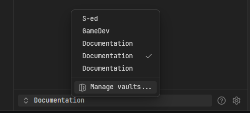
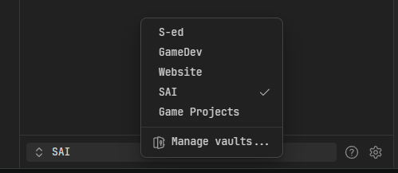

# Vault Aliases

An Obsidian desktop plugin that shows your own display names for vaults.

Obsidian names every vault after its folder, so several vaults whose folder is called `Documentation` or `Notes` look the same in the vault switcher. Vault Aliases lets you give each vault a name of your choice. No folder or path is renamed; only what Obsidian displays changes.

| Without the plugin | With the plugin |
| --- | --- |
|  |  |

> [!WARNING]
> Obsidian has no public API for vault names, so this plugin relies on Obsidian internals. An Obsidian update can stop it working. Disabling the plugin restores Obsidian's own behaviour at once. Details: [Limits and fragility](#limits-and-fragility).

## What it changes

- **Vault switcher** (the menu at the bottom of the left sidebar): lists every vault by its alias. The plugin replaces Obsidian's menu with its own, built from the same vault list, with the current vault checked and a **Manage vaults...** entry at the end.
- **Vault name label** at the bottom-left of the window.
- **Window title**: the vault part of `<note> - <vault> - Obsidian`.

The **Manage vaults** window is not changed, because plugins do not run there. It shows each vault's path.

## Install

There is no build step. The plugin is two files, `main.js` and `manifest.json`.

1. In your vault, create the folder `.obsidian/plugins/vault-aliases/`.
2. Copy `main.js` and `manifest.json` into it.
3. In Obsidian, open **Settings → Community plugins**, turn off Restricted mode if it is on, and enable **Vault Aliases**.

Repeat steps 1 to 3 in every vault where you want the aliases shown. A vault without the plugin shows folder names as before.

## Setting aliases

Open **Settings → Vault Aliases**. The page lists every vault Obsidian knows, with its path. Type a name next to a vault and press Enter or leave the field. The change applies immediately.

A vault's displayed name is looked up in this order:

1. **Your alias** for it, from your alias file (below).
2. **The vault's own alias**, if the vault carries one (below).
3. The folder name.

An empty field means you have no alias of your own for that vault, so it falls back to 2 or 3. The field's placeholder shows what that would be.

Each row has a **reset** button (↺) that removes your alias, so the vault's own alias or the folder name shows again. The row of the vault you are in also has a **save** button (↑) that stores your current alias as the vault's own alias. If the vault already carries a different alias, it asks first ("Change alias? Old → New").

### The vault's own alias

A vault can carry one alias for itself, in its config folder: `<vault>/.obsidian/vault-alias.json`.

```json
{ "version": 1, "alias": "Work docs" }
```

It travels with the vault. If the vault is a shared or cloned repository and `.obsidian/vault-alias.json` is committed, everyone who uses the plugin sees that name until they set their own.

- The plugin only ever writes this file for the vault it is running in, and only when you press the save button.
- It reads the file of every listed vault to name it in the switcher. For the current vault it uses the configured config folder; for other vaults it assumes `.obsidian`.
- To remove a vault's own alias, delete the file. The settings page shows its path for the current vault.

If you share a vault through git, commit `.obsidian/vault-alias.json` but not `.obsidian/plugins/vault-aliases/data.json`: that file holds a path on your own machine.

### Your alias file

Your own aliases are stored in one JSON file outside all vaults, so that every vault with the plugin enabled shows the same names:

```json
{
  "version": 1,
  "aliases": {
    "C:\\Users\\me\\Work\\Documentation": "Work docs",
    "D:\\Projects\\game\\Documentation": "Game design"
  }
}
```

- The **Alias file** setting holds the path of this file. It is saved per vault, so if you change it, set the same path in each vault.
- The default is `vault-aliases.json` in Obsidian's own per-user settings folder, next to `obsidian.json`: `%APPDATA%\obsidian` on Windows, `~/Library/Application Support/obsidian` on macOS, `$XDG_CONFIG_HOME/obsidian` or `~/.config/obsidian` on Linux. Because every vault uses the same default, the names are shared without any setup. Change the path only if you want the file somewhere else, for example in a synced folder.
- The default is worked out on your machine each time the plugin loads, from the operating system's own values (`APPDATA`, your home folder). It does not follow a custom Obsidian data folder. A path is saved, in the plugin's `data.json` inside the vault, only once you edit the **Alias file** field.
- The file and its folder are created on the first save. Vault paths are matched without regard to letter case or trailing slashes.
- **Reload** re-reads the file, for example after editing it by hand or changing aliases from another vault. The switcher menu also re-reads it each time it opens.

## Limits and fragility

- **Desktop only.** It uses Node and Electron, which Obsidian mobile does not have.
- **Tested on Windows only**, against one Obsidian build (minimum app version in the manifest: 1.5.0).
- **It relies on Obsidian internals that are not public API**:
  - the `vault-list`, `vault` and `vault-open` IPC calls;
  - the sidebar elements `.workspace-drawer-vault-switcher` and `.workspace-drawer-vault-name`;
  - the format of the window title.

  An Obsidian update can break any of these. After updating, check that the vault switcher still opens and switches vaults. Disabling the plugin restores Obsidian's own behaviour at once.
- The plugin's switcher menu lists vaults and **Manage vaults...** only. Anything else Obsidian puts in its own menu is not reproduced.

## Uninstall

Disable the plugin and delete `.obsidian/plugins/vault-aliases/` from each vault. Your alias file and any `vault-alias.json` in a vault's config folder are left in place; delete them yourself if you no longer want them.

## Development

Plain JavaScript in a single file; edit `main.js` and copy it to a vault's plugin folder, then reload Obsidian (or disable and re-enable the plugin). There are no dependencies. `node tests/test-aliases.cjs` checks the lookup order and the two alias stores with Obsidian stubbed out; the settings page and the switcher menu are not covered by it.

## Changes

- **1.1.1**: the save button asks before replacing a different alias the vault already carries; shorter introduction on the settings page, with a hint on removing a vault's own alias.
- **1.1.0**: a vault can carry its own alias in `vault-alias.json`, used when you have no alias of your own for it; reset and save buttons on the settings page.
- **1.0.0**: aliases in the vault switcher, the vault name label and the window title; one shared alias file, by default in Obsidian's per-user settings folder.

## License

MIT. See [LICENSE](LICENSE).
